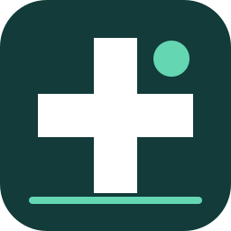

# Clínica Favmed - Medicina Ocupacional

Servidor de integração MCP com a API Quarks para apoiar as rotinas de agendamento da clínica.

**Versão:** 2.1.0  
**Idioma:** Português do Brasil  
**Instalação prevista:** uma clínica / uma unidade operacional

> Este repositório contém o serviço de integração (backend), não uma interface gráfica completa de recepção. As ferramentas disponíveis dependem dos recursos habilitados na API Quarks e das credenciais fornecidas pela clínica.

## Melhorias da versão 2.1

- Nome e identificação atualizados para **Clínica Favmed - Medicina Ocupacional**.
- Ícone vetorial próprio para a marca.
- Autenticação obrigatória por token Bearer em todas as rotas MCP.
- CORS desativado por padrão; origens confiáveis podem ser configuradas.
- Limite de 1 MB para o corpo das requisições.
- Remoção de logs de parâmetros, corpos de requisição e respostas que poderiam conter dados pessoais ou de saúde.
- Respostas de erro sem detalhes internos ou conteúdo da API.
- Timeout configurável para chamadas à API Quarks.
- Correção do tratamento de respostas JSON inválidas, sem referência a variável fora do escopo.
- Verificação de saúde simplificada, sem revelar configuração interna.
- Script `npm run mcp` corrigido para iniciar o servidor existente.

## Guia recomendado: computador Windows na rede local

Siga o guia completo: **[Configuração local do Windows e rede da clínica](docs/CONFIGURACAO-LOCAL-WINDOWS.md)**.

Ele explica os requisitos do computador, instalação, criação do arquivo privado `.env`, geração de token de acesso, regras do Firewall do Windows e os dados a solicitar à Quarks. Não encaminhe a porta do servidor para a internet.

## Requisitos

- Node.js 20 ou superior
- Credenciais válidas da API Quarks
- Um token privado para autenticar o cliente MCP

## Configuração resumida

1. Baixe e extraia o projeto no computador da clínica.
2. Copie `.env.example` para um arquivo local chamado `.env`.
3. Configure `MCP_AUTH_TOKEN` com um token aleatório forte.
4. Configure as credenciais Quarks somente após obtê-las de uma fonte autorizada.
5. Instale as dependências com `npm install` e inicie com `npm start`.

Não publique o arquivo `.env`, nem coloque credenciais reais em commits, capturas de tela ou mensagens. Se alguma credencial verdadeira já foi publicada no histórico do GitHub, substitua-a junto ao fornecedor; apagar o arquivo atual não remove cópias antigas do histórico.

## Variáveis de ambiente

| Variável | Obrigatória | Finalidade |
|---|---|---|
| `MCP_AUTH_TOKEN` | Sim para usar MCP | Autentica o cliente com Bearer token |
| `QUARKS_API_TOKEN` | Sim para chamadas à Quarks | Token de acesso à API |
| `QUARKS_CHAVE_KEY` | Conforme operação | Chave adicional da API |
| `QUARKS_SECRET_KEY` | Conforme operação | Chave secreta adicional da API |
| `QUARKS_API_URL` | Não | URL base da API Quarks |
| `QUARKS_API_TIMEOUT_MS` | Não | Tempo limite, de 1.000 a 60.000 ms |
| `CORS_ORIGINS` | Não | Origens web autorizadas, separadas por vírgula |

A rota `/mcp` responde com erro 503 quando `MCP_AUTH_TOKEN` não está configurado. A rota `/health` é pública e retorna apenas o estado básico do serviço.

## Rotas

- `GET /` — identificação do serviço.
- `GET /health` — disponibilidade básica.
- `GET /favicon.svg` — ícone do serviço.
- `POST /mcp` — endpoint MCP autenticado.
- `GET /mcp/tools` — lista de ferramentas, autenticada.
- `GET /mcp/tools/:toolName` — esquema de uma ferramenta, autenticado.

Envie o token no cabeçalho `Authorization: Bearer SEU_TOKEN`. Nunca inclua esse token na URL.

## Ferramentas

O serviço expõe as ferramentas de agendamentos, agendas, convênios e profissionais definidas em `src/tools/quarks-tools.js`. A lista efetiva pode ser consultada em `GET /mcp/tools` com autenticação válida. Nomes técnicos de ferramentas são mantidos para compatibilidade; descrições e documentação devem permanecer em português.

## Uso em uma única clínica

Configure as variáveis de ambiente no computador servidor. Os identificadores de agenda, convênio, profissional e unidade enviados à API continuam dependendo do cadastro existente na Quarks. Não fixe um `unidadeId` no código sem confirmar o identificador correto com o administrador da clínica.

Restrinja o acesso à rede interna e ao computador servidor a pessoas autorizadas. Antes de usar dados reais, valide o token, as permissões da API e os fluxos de consulta e alteração com dados de teste.

## Testes e validação

- `npm test` — executa os testes automatizados presentes no projeto.
- `npm start` — inicia o servidor.

A versão deve ser testada no ambiente da clínica antes do uso real. Este repositório não substitui os controles de acesso da API Quarks nem as políticas internas de proteção de dados da clínica.

## Licença

MIT
